<picture>
  <source media="(prefers-color-scheme: dark)" srcset="assets/hero-dark.svg">
  
</picture>

```
▶ steven roman — founder · builder
  ✔ builds the software his companies run on
  ✔ ships it with AI agents, under rules that live in code
  ✔ 1 ticket = 1 Claude Code session = 1 branch = 1 PR, merged by hand

▶ shipping
  ✔ scalecall    in-house dialer · live transcript · AI whisperer
  ✔ homotope     raster → vector (SVG, DXF, PDF) · open engine on npm
  ✔ biex         Socratic AI tutor, ages 7–17 · the model talks, code decides
  ✔ éclair       AI training by job role · SDRs first
  ✔ atalaya      security-news monitoring · Latin America
  ✔ lumi         French mini-games for kids living abroad

▶ principles
  ✔ the rule lives in code, never in a prompt
  ✔ an outage is never an empty list            "unavailable" ≠ "none"
  ✔ every AI call is measured                   sovereign EU by default
  ✔ a computed verdict recommends               a human click decides
  ✖ a guard is proven red by breaking the code
      expected: red
      actual:   red
      → that's how you know it guards something.

ℹ tests 14
ℹ pass 13
ℹ fail 1 (on purpose)
ℹ stack node · typescript · python · postgres+pgvector · railway · scaleway · claude code
ℹ duration_ms 6 months, ~1,700 merged PRs
```

<p align="center">
  <a href="https://scalefast.fr">scalefast.fr</a> ·
  <a href="https://homotope.app">homotope.app</a> ·
  <a href="https://github.com/stevenroman91/homotope-engine">@homotope/engine</a> ·
  <a href="https://www.linkedin.com/in/steven-roman-g/">LinkedIn</a>
</p>

<details>
<summary>🇫🇷 <b>En français</b></summary>

```
▶ steven roman — fondateur · bâtisseur
  ✔ construit le logiciel sur lequel tournent ses entreprises
  ✔ le livre avec des agents IA, sous des règles écrites en code
  ✔ 1 ticket = 1 session Claude Code = 1 branche = 1 PR, mergée à la main

▶ en production
  ✔ scalecall    dialer maison · transcript live · souffleur IA
  ✔ homotope     raster → vecteur (SVG, DXF, PDF) · moteur open source
  ✔ biex         tuteur IA socratique, 7–17 ans · le modèle parle, le code décide
  ✔ éclair       formation à l'IA par métier · les SDR d'abord
  ✔ atalaya      veille sécurité automatisée · Amérique latine
  ✔ lumi         jeux de français pour enfants expatriés

▶ principes
  ✔ la règle vit en code, jamais en prompt
  ✔ une panne n'est jamais une liste vide       « indisponible » ≠ « aucun »
  ✔ tout appel IA se mesure                     souverain UE par défaut
  ✔ un verdict calculé recommande               le clic humain tranche
  ✖ une garde se prouve rouge en cassant le code
      attendu : rouge
      obtenu :  rouge
      → c'est comme ça qu'on sait qu'elle garde quelque chose.

ℹ tests 14
ℹ pass 13
ℹ fail 1 (exprès)
ℹ duration_ms 6 mois, ~1 700 PRs mergées
```

</details>
